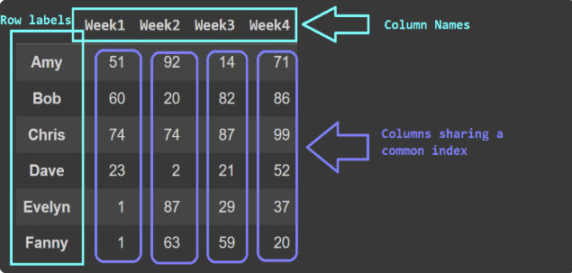
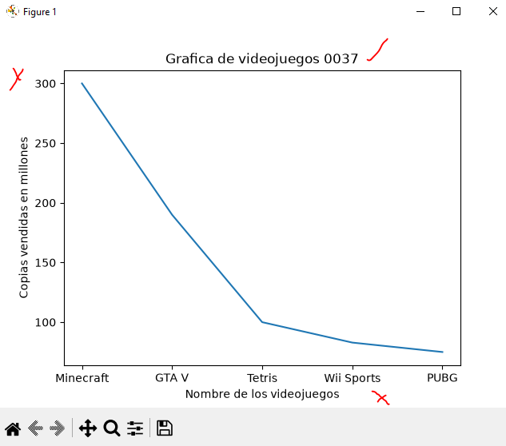
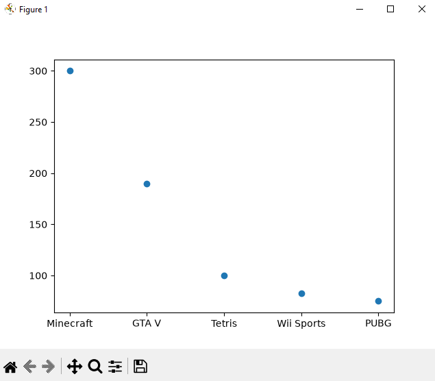
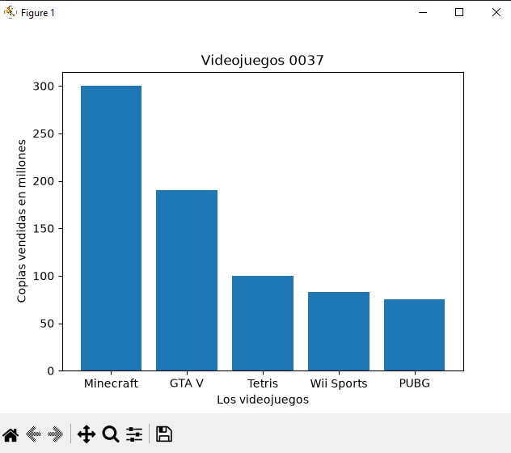
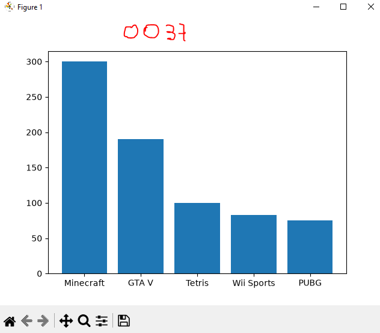
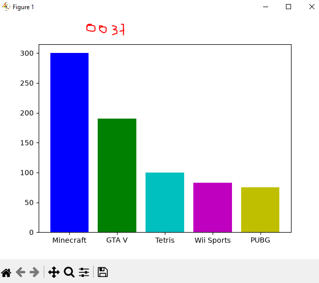
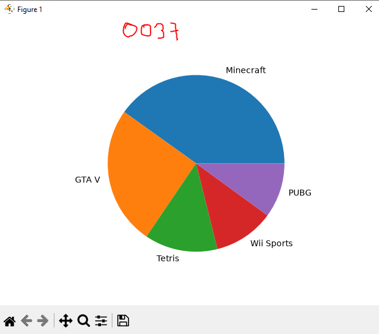

## dataframe o marco de datos pandas

## Videojuegos populares

## grafica lineal de videojuegos populares

## grafica puntos de videojuegos populares

## grafica de barras de videojuegos populares

## grafica de barras del mas grande al chico Descendente

## Coloreando la grafica

## Grafica de pastel o pie
